# YunOJ

YunOJ 是面向校园教学、日常练习与程序设计竞赛的在线评测系统。项目包含题库、代码评测、比赛、动态滚榜、教学空间、个人中心、全站排名和测评集群管理。

## 主要能力

- 题目与测试点管理：题面、难度、标签、时间/内存限制、逐点分值、测试点 ZIP 导入与预览
- 题目迁移包：管理员可导出题面、评测器配置与测试点，导入后自动创建为草稿，便于跨实例迁移
- 评测状态：AC、WA、PE、TLE、MLE、OLE、RE、CE、SE，并保留每个测试点的结果
- 题目类型：标准评测、函数题（LeetCode 风格，只写函数体）、Codeforces 风格 Hack 题、SPJ、交互题接口与输出题接口
- 在线 IDE：代码草稿、最近提交恢复、样例运行、自测与逐点结果
- 比赛：ACM、OI、IOI 和自定义计分模板，支持个人或团体报名
- 比赛运维：题目管理、参赛者管理、广播、对话式答疑、榜单导出和时间线数据包
- 动态榜单：封榜、逐条揭晓、快速最终榜与实时更新事件
- 教学空间：班级/团体、作业、测试与完成情况
- 用户侧：个人中心、头像、提交记录、参赛记录、刷题热力图、收藏与通知
- 全站排名：综合分、难度权重与用户名等级颜色
- 测评集群：节点心跳、动态并发、平滑排空、语言启停、队列统计与操作审计

## 界面预览

| 首页 · 继续刷题 | 题库 · 筛选与状态 |
| --- | --- |
| 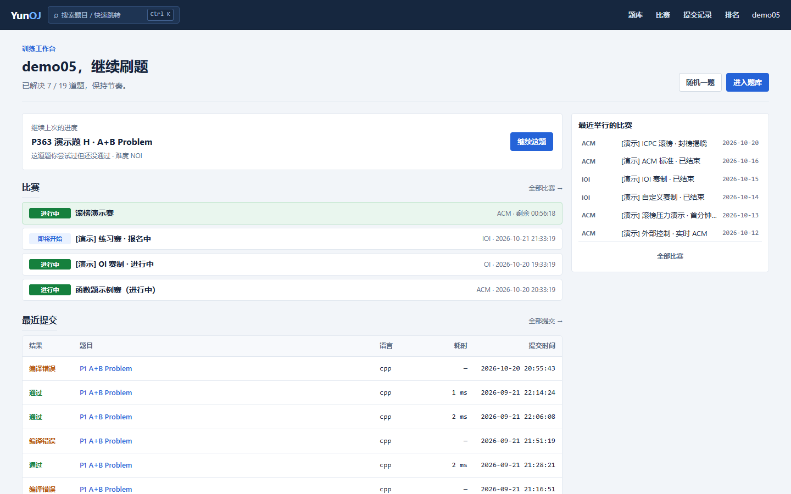 | 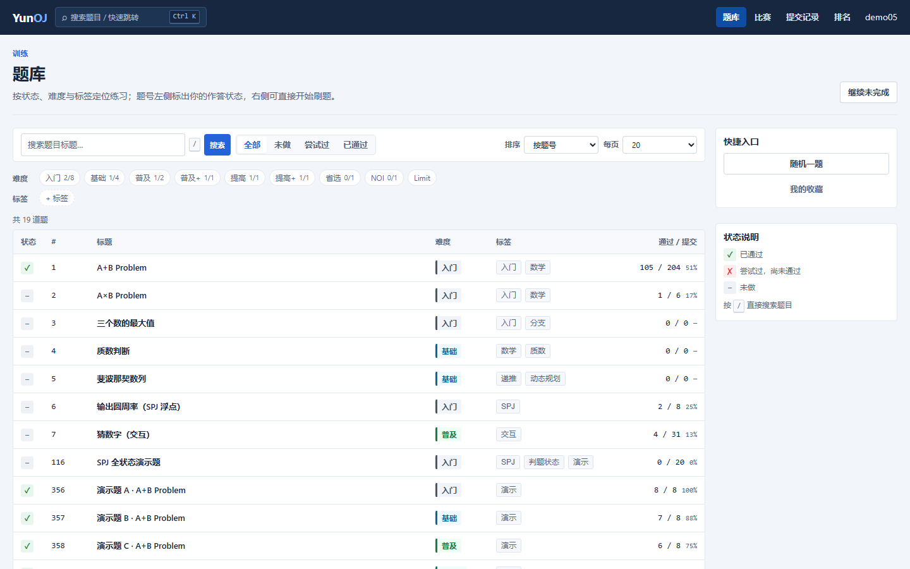 |

| 单题工作台 · 左题面右编辑器 | 比赛列表 · 按状态分组 |
| --- | --- |
| 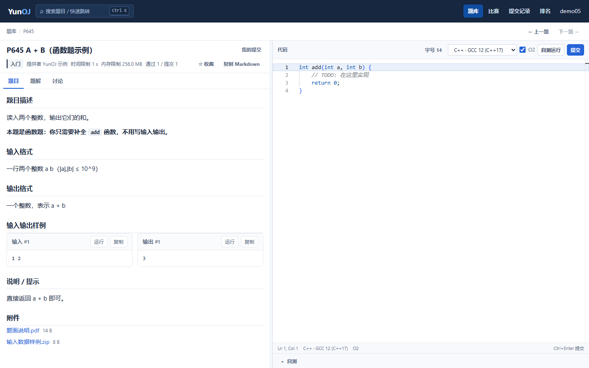 | 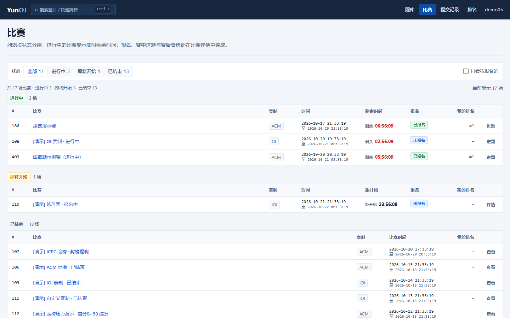 |

| 比赛内做题 · 附件与函数骨架 | 比赛榜单 · 滚榜 |
| --- | --- |
| 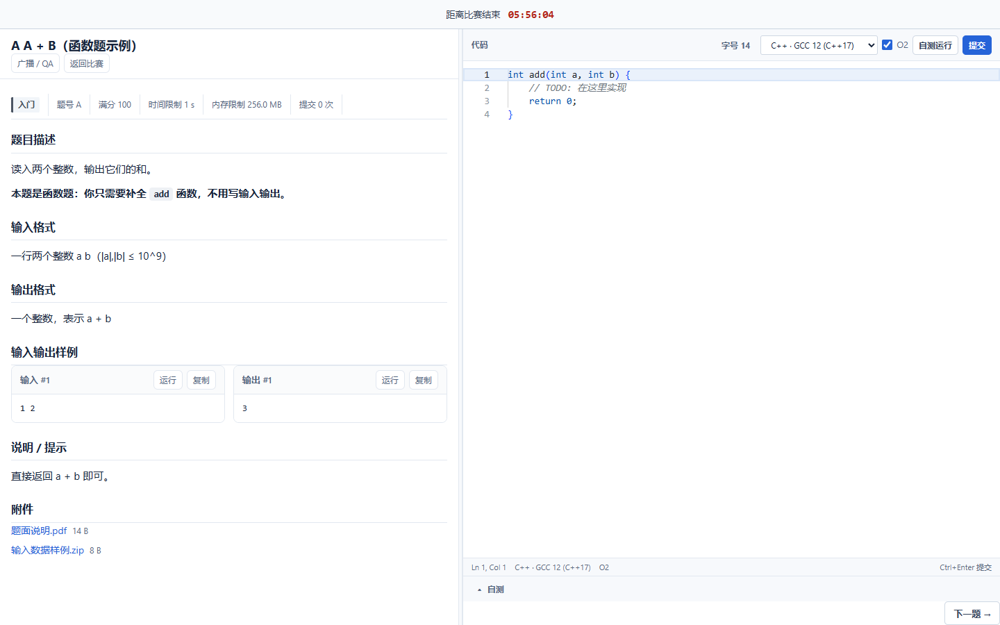 | 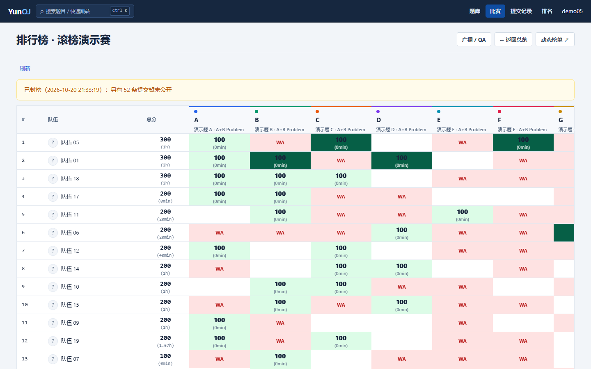 |

| 提交记录 | 全站排名 |
| --- | --- |
| 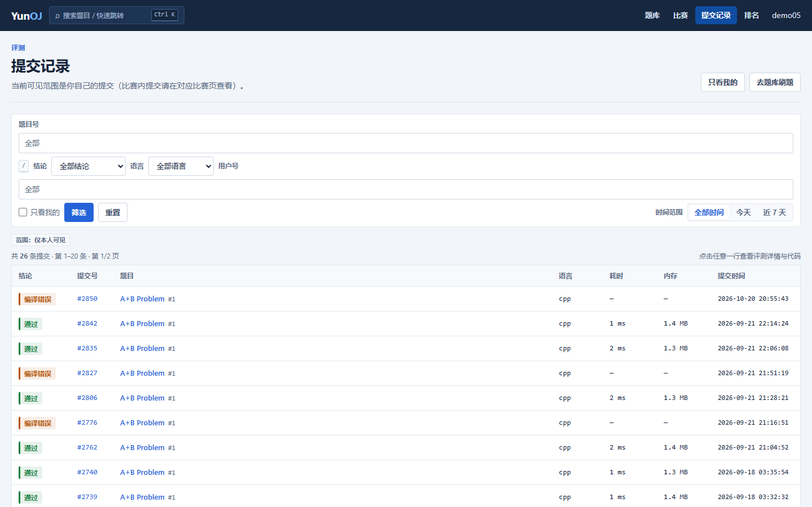 | 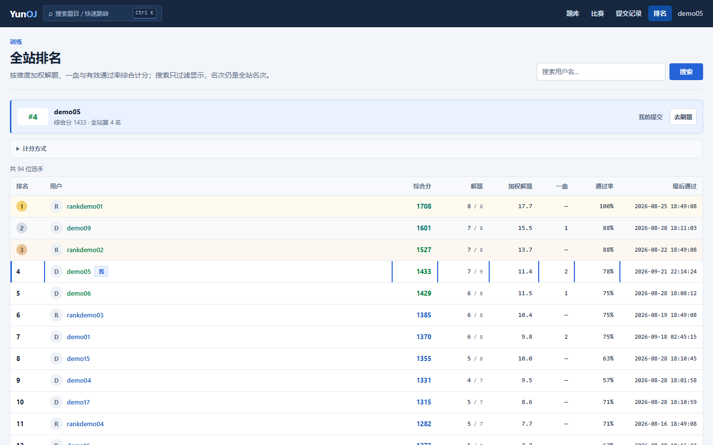 |

| 个人中心 | 函数题模板配置 |
| --- | --- |
| 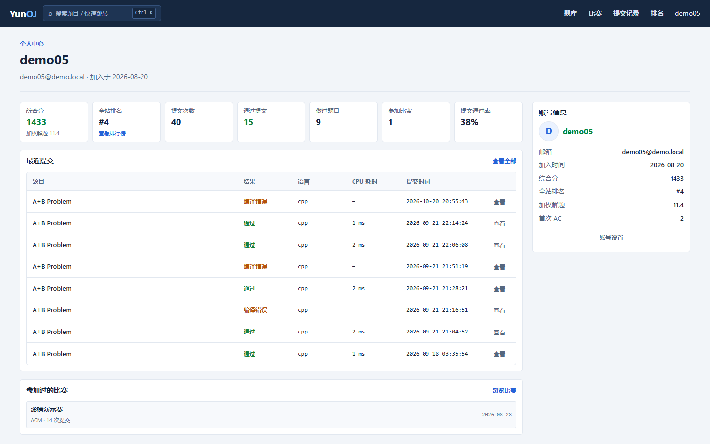 | 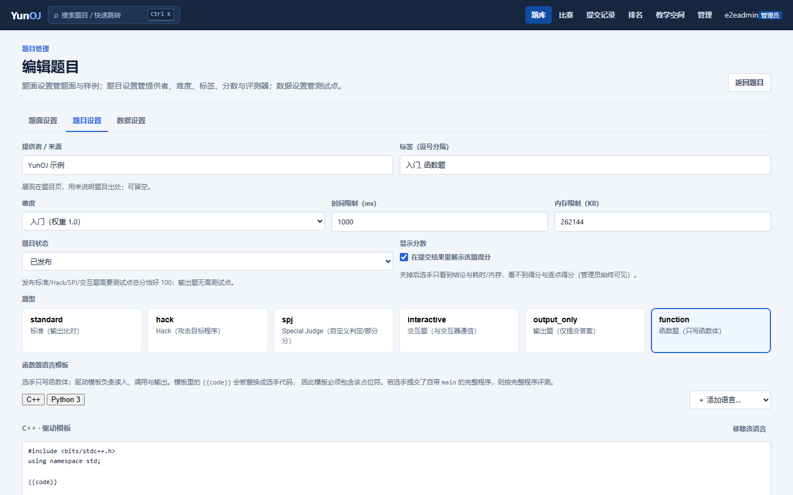 |

| 测评集群管理 | 动效组件演示 |
| --- | --- |
| 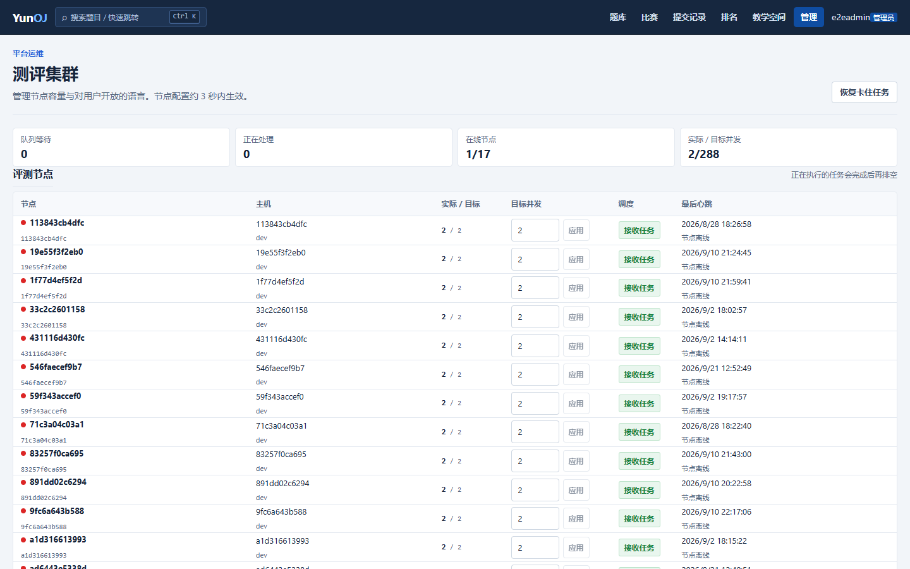 | 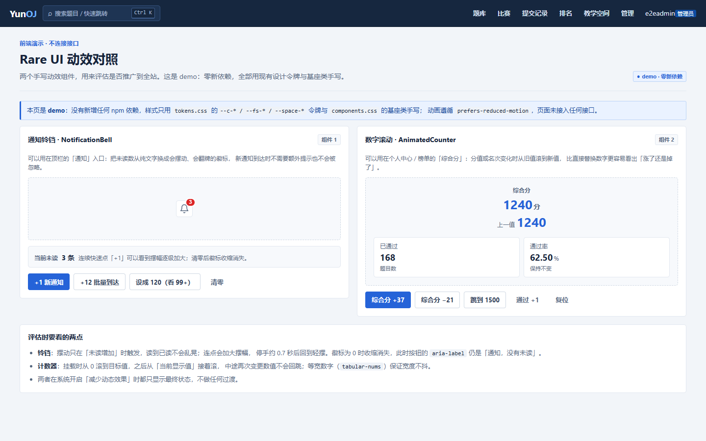 |

截图放在 `docs/screenshots/`，由 `scripts/uiprobe/shoot-readme.mjs` 生成；每张都会断言页面有实际内容，
避免拍成空状态。重新生成：

```bash
node scripts/uiprobe/shoot-readme.mjs docs/screenshots
```

## 项目结构

```text
backend/                 Go API、评测守护进程、数据库迁移与领域逻辑
  cmd/server/            HTTP API 服务
  cmd/judge/             测评节点进程
  cmd/seedcontests/      比赛流程演示数据
  cmd/seedhack/          Hack 题与 Hack 比赛演示数据
  internal/              API、Store、Queue、Judge、Contest 等模块
frontend/                React + TypeScript 前端
  src/                   页面、组件与样式
  server.mjs             生产环境 SPA 静态服务与 API 反向代理
config/                  受信任的语言配置
scripts/                 开发和比赛控制脚本
data/                    运行时题目数据，不纳入版本控制
third_party/isolate/     固定版本的 isolate 沙箱源码
toolchains/              可挂载的自有工具链目录
docker-compose.yml       前端、后端、数据库、Redis 与测评节点编排
```

## 架构

```text
Browser
   |
Frontend (React static service)
   |
Backend API -------- PostgreSQL
   |                     |
   +------ Redis Queue --+
              |
       Judge Node 1..N
              |
       Shared DATA_DIR
```

前端与后端分别构建和部署。API 不再携带前端静态文件，前端服务负责 SPA 路由和 `/api` 反向代理。

评测节点不提供公网端口。每个节点使用唯一的节点 ID 注册，生产环境应显式配置稳定的 `JUDGE_NODE_ID`；worker 使用“节点 ID + 槽位”作为全局唯一消费者 ID。提交由数据库条件更新原子领取，因此重复队列消息或多节点并发不会导致同一提交被重复执行。

## 本机环境约定（Docker 跑在 WSL Arch 里）

本项目的容器**运行在 WSL Arch 发行版内**（`D:\arch`，自带 systemd 与 Docker Engine），不再依赖 Docker Desktop。

要点：

- 仓库在 Windows 侧 `D:\git\YunOJ`，WSL 里对应 `/mnt/d/git/YunOJ`；`data/` 与 `config/` 由两侧共享，无需同步。
- 容器端口绑定在 WSL 的 `127.0.0.1`，经 WSL 端口转发后，**Windows 侧仍可用 `localhost` 访问**（`5432`/`6379`/`8090`）。
- WSL Arch 内 `/etc/docker/daemon.json` 配置了国内 registry 镜像（`docker.1ms.run`、`docker.m.daocloud.io`、`dockerproxy.net`）与日志轮转，因此 `REGISTRY_PREFIX` 可留空。
- WSL 里 Docker Hub 直连不可用、Windows 侧 v2ray 只监听 `127.0.0.1`（NAT 模式 WSL 访问不到），所以**所有镜像拉取都走上述镜像源**；`goproxy.cn`、`registry.npmjs.org` 在 WSL 内可直连。
- 本机 `8080` 被 National Instruments 的 `NIApplicationWebServer` 服务占用，故 YunOJ 统一使用 **8090**（`.env` 的 `HTTP_PORT`、`scripts/dev-server.ps1` 的 `SERVER_ADDR`、前端 vite 代理目标三者一致）。

从 Windows 侧管理 WSL 里的容器：

```powershell
pwsh -File scripts/wsl-docker.ps1            # 状态：WSL/Docker 版本、容器、端口可达性
pwsh -File scripts/wsl-docker.ps1 up         # 启动 postgres redis judge
pwsh -File scripts/wsl-docker.ps1 ps
pwsh -File scripts/wsl-docker.ps1 logs judge
pwsh -File scripts/wsl-docker.ps1 build       # 重建镜像（isolate 编译较慢）
pwsh -File scripts/wsl-docker.ps1 db-shell    # 进 psql
pwsh -File scripts/wsl-docker.ps1 db-backup   # 导出数据库到 .tools/migration/
```

也可以直接在 WSL 里操作：

```bash
wsl -d Arch --cd /mnt/d/git/YunOJ
docker compose up -d postgres redis judge
```

数据迁移与备份脚本（一次性工具，位于 `.tools/`，不纳入版本控制）：
`wsl-setup-docker.sh`（配置镜像源）、`wsl-restore-db.sh`（从 dump 恢复）、`wsl-compose.sh`（WSL 内 compose 包装）。

## 快速部署

前置条件：

- Docker Engine 与 Docker Compose
- 支持 Linux namespace 的环境
- 生产环境需准备强随机 JWT 密钥和数据库密码

启动全部服务：

```bash
cp .env.example .env
docker compose up -d --build
```

通过 `HTTP_PORT` 对应的部署域名访问站点（本机为 <http://localhost:8090>）。首次注册账号会成为管理员，正式开放注册前应先完成管理员初始化并检查注册策略。

停止服务：

```bash
docker compose down
```

数据库保存在命名卷中，题目数据保存在 `data/`。删除卷或数据目录前必须先完成备份。

## 本地开发

先启动依赖（本机在 WSL Arch 里，见上一节）：

```bash
docker compose up -d postgres redis
# 或从 Windows 侧：pwsh -File scripts/wsl-docker.ps1 up postgres redis
```

启动后端（默认监听 8090，因为 8080 被 NI 服务占用）：

```powershell
pwsh -File scripts/dev-server.ps1
```

启动前端：

```bash
cd frontend
npm ci
npm run dev
```

前端 dev server 监听 5173，`/api` 代理到 `http://localhost:8090`（由 `frontend/vite.config.ts` 的 `VITE_API_TARGET` 控制，可通过 `frontend/.env.local` 覆盖）。

测评沙箱依赖 Linux。可以使用 Compose 启动测评节点：

```bash
docker compose up -d judge
```

也可以在已安装 isolate 的 Linux 主机（含 WSL Arch）上运行：

```powershell
pwsh -File scripts/dev-judge.ps1
```

## 测评集群

管理员可在“测评集群”页面查看：

- 节点在线状态、版本与最后心跳
- 实际并发和目标并发
- 排队与处理中任务数
- 每种语言的开放状态
- 提交状态汇总和配置变更记录

将节点目标并发设为 `0` 或关闭调度时，节点停止领取新任务，正在运行的任务会完成后退出，不会被强制终止。后台配置通常在一个心跳周期内生效。

单机增加节点实例：

```bash
docker compose up -d --scale judge=3
```

多机部署还必须满足：

1. 所有后端和测评节点连接同一 PostgreSQL 与 Redis。
2. 所有测评节点使用唯一的 `JUDGE_NODE_ID`；未设置时使用主机名。
3. 所有节点读取一致的 `config/languages.json`。
4. `DATA_DIR` 必须是所有 API 与测评节点可见的共享存储，例如 NFS 或 CephFS。
5. 测评节点应部署在专用 Linux 主机，并限制出站网络和宿主机权限。

当前管理页只允许启停服务端已经加载的受信任语言。新增编译器需要先修改语言配置并在节点安装对应工具链；管理 API 不接受任意编译命令，以免形成远程命令执行入口。

## 自定义语言

在 `config/languages.json` 中声明语言。命令以参数数组执行，不经过 shell；编译命令必须使用 `{source}` 与 `{output}` 占位符。

```json
{
  "languages": [
    {
      "key": "example",
      "name": "Example",
      "version": "toolchain-version",
      "monaco": "plaintext",
      "source_file": "main.example",
      "run_command": ["/opt/toolchains/example", "main.example"],
      "time_factor": 1,
      "memory_factor": 1,
      "processes": 16
    }
  ]
}
```

配置文件属于受信任的服务器配置。修改后需要重启 API 和各测评节点，使语言清单和执行能力保持一致。

## 比赛演示与控制

生成不同赛制、封榜阶段和并发提交的演示比赛：

```bash
go -C backend run ./cmd/seedcontests
```

重建演示数据：

```bash
go -C backend run ./cmd/seedcontests -reset
```

创建一题可提交的 Hack 题和一场公开 Hack 比赛（幂等，可重复执行）：

```bash
go -C backend run ./cmd/seedhack
```

该命令会创建/复用“Hack 题 · 反转序列”和“Hack 题挑战赛 · 反转序列”，并写入一段公开的待攻击程序。Hack 评测机把选手提交的文本作为标准输入运行该程序；程序出现 WA、TLE、MLE 或 RE 时 Hack 成功，正常结束时 Hack 失败。旧版生成器/参考解字段仍保留用于兼容迁移数据。

控制比赛阶段：

```bash
python scripts/contest_phase_control.py --help
python scripts/contest_control.py --help
```

控制脚本通过 API 操作比赛，不直接修改数据库；服务地址和凭据应通过脚本参数提供。

## 测试与构建

后端：

```bash
go -C backend test ./...
go -C backend build ./cmd/server
go -C backend build ./cmd/judge
```

前端：

```bash
cd frontend
npm ci
npm run build
```

检查 Compose：

```bash
docker compose config
```

## 题目迁移包格式

题目管理页的“导出”会生成一个 ZIP，包含 `problem.json` 和 `tests/N.in`、`tests/N.out`。
导入时会校验路径、条目数量、文件大小、测试点配对与总分；导入结果始终是草稿，需管理员检查后发布。
如果 `problem.json` 省略 `testcases`，标准题会按测试点数量自动均分；如果提供清单，则编号和分值必须与文件完全匹配。
迁移包版本通过 `problem.json` 的 `version` 字段标识，目前为 `1`。接口仅对管理员开放：

```text
POST /api/problems/import   multipart(file=<package.zip>)
GET  /api/problems/{id}/package
```

## 函数题（LeetCode 风格）

题型 `function`：题目只提供函数签名，选手不用写输入输出。在「题目设置」里按语言配置两项内容：

- **驱动模板**：完整的可运行程序，用 `{{code}}` 标记选手代码的插入位置。例如 C++：

  ```cpp
  #include <bits/stdc++.h>
  {{code}}
  int main() { int a, b; std::cin >> a >> b; std::cout << add(a, b) << std::endl; }
  ```

- **初始代码**：选手打开编辑器时看到的骨架（即函数签名），例如 `int add(int a, int b) { }`。**必填** ——
  留空会让选手面对一个空编辑器，与力扣「打开就是函数的样子」不一致。

评测时把选手代码拼进模板再编译，随后走与标准题完全相同的测试点与判定通路（`token` / `exact` 均支持）。
选手如果提交了自带 `main`（Python 为 `if __name__`）的完整程序，则原样评测，不会拼出重复入口 —— 因此两种写法都能过。
编辑器工具栏有「恢复函数」，可把改乱的代码一键还原成骨架（内容与骨架一致时按钮自动隐藏）。

可见性与力扣一致：**初始代码（函数签名）下发给选手**（含比赛内），**驱动模板只在管理端可见** ——
模板里的读入/调用/输出是评测约定，公开等于让选手针对驱动写死输出。题目迁移包包含模板。

## 环境变量

| 变量 | 用途 |
| --- | --- |
| `APP_ENV` | 运行环境；`production` 启用严格安全配置校验 |
| `POSTGRES_PASSWORD` | Compose 数据库密码 |
| `DATABASE_URL` | PostgreSQL 连接串 |
| `REDIS_ADDR` | Redis 地址 |
| `JWT_SECRET` | 登录令牌签名密钥 |
| `CORS_ALLOWED_ORIGINS` | 允许直接跨域调用 API 的来源白名单，逗号分隔 |
| `TRUST_PROXY` | API 是否信任受控反向代理传入的客户端地址 |
| `SERVER_ADDR` | API 监听地址 |
| `DATA_DIR` | 题目测试数据目录 |
| `LANGUAGE_CONFIG` | 受信任语言配置路径 |
| `HTTP_PORT` | 前端服务公开端口 |
| `JUDGE_WORKERS` | 节点首次注册时的目标并发 |
| `JUDGE_NODE_ID` | 集群内唯一节点 ID |
| `JUDGE_NODE_NAME` | 节点展示名称 |
| `JUDGE_VERSION` | 节点版本标识 |
| `ISOLATE_PATH` | isolate 可执行文件 |
| `ISOLATE_DIR` | isolate 沙箱根目录 |
| `ISOLATE_CG` | 是否启用 cgroup 精确计量 |

## 安全边界

- 用户代码只应在 isolate 沙箱内运行，API 服务不得直接执行用户代码。
- 测评节点需要较高宿主权限，应与数据库、业务 API 和其他内部系统隔离。
- 生产环境不要使用示例密钥和密码，不要公开 PostgreSQL、Redis 或测评节点端口。
- 生产环境设置 `APP_ENV=production`；服务会拒绝短于 32 字符的 JWT 密钥和通配 CORS。
- 登录与注册已按来源和账号组合限流；多实例部署必须共用 Redis 才能保持全局生效。
- 比赛盲评和封榜结果由 API 权限逻辑控制，新增接口时必须复用相同的可见性检查。
- 上传的题目数据、头像与比赛封面应在反向代理层配置请求大小和速率限制。
- 管理操作应继续补充更完整的审计、二次确认和告警。

## 待办

- 部署管理页：环境检查、迁移状态、备份状态、版本与滚动升级
- 自动密钥体系：按用途生成可撤销、可过期、可轮换的 API Key、测评节点注册密钥、导入令牌和一次性用户激活密钥；数据库仅保存密钥哈希与前缀，支持 scope 权限、最后使用时间和审计记录
- 将共享文件目录抽象为对象存储，降低多机挂载依赖
- 测评节点能力调度：按语言、架构和空闲资源选择节点
- 节点证书或服务身份认证，避免未授权节点注册
- 二次认证、会话撤销、设备管理与更细的密码策略
- 指标、日志聚合、告警与队列积压自动扩容
- 大型前端模块按路由拆包，进一步缩短首次加载时间

## 说明

项目仍处于持续开发阶段。用于正式比赛或教学前，应在目标 Linux 环境完成沙箱逃逸检查、资源限制压力测试、断电恢复演练、备份恢复演练和权限审计。
